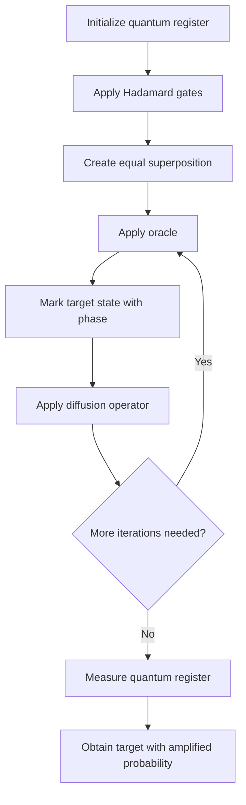
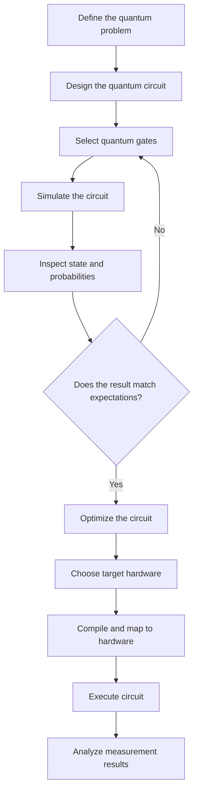
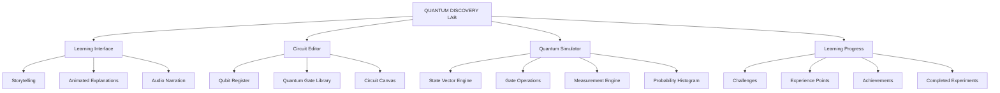

# La-Petite-Princess-Entangled-Circuits

# 🌌 Quantum Circuits: An Interactive Journey into Quantum Computing

### A technical and visual learning guide for the next generation of quantum scientists, engineers, mathematicians, and innovators.


---

# TABLE OF CONTENTS

1. [Introduction: Enter the Quantum Universe](#1-introduction-enter-the-quantum-universe)
2. [Understanding Qubits and Quantum States](#2-understanding-qubits-and-quantum-states)
3. [Understanding Quantum Gates](#3-understanding-quantum-gates)
4. [How to Read Quantum Circuit Diagrams](#4-how-to-read-quantum-circuit-diagrams)
5. [Superposition: Building Your First Quantum Circuit](#5-superposition-building-your-first-quantum-circuit)
6. [Entanglement: Creating Connected Quantum States](#6-entanglement-creating-connected-quantum-states)
7. [Quantum Teleportation: Transferring Quantum Information](#7-quantum-teleportation-transferring-quantum-information)
8. [Quantum Algorithms: Grover's Search](#8-quantum-algorithms-grovers-search)
9. [Quantum Circuit Simulation, Measurement and Hardware](#9-quantum-circuit-simulation-measurement-and-hardware)
10. [Interactive Learning Architecture and Future Development](#10-interactive-learning-architecture-and-future-development)

---

# 1. INTRODUCTION: ENTER THE QUANTUM UNIVERSE

## 1.1 What is quantum computing?

Quantum computing is a way of processing information using principles of quantum mechanics.

Traditional computers manipulate information through classical bits, which represent either 0 or 1.

Quantum computers use quantum bits, called **qubits**, which can be prepared in quantum states involving combinations of the classical basis states 0 and 1.

This allows quantum circuits to perform computations using behaviours such as:

- Superposition.
- Quantum interference.
- Entanglement.
- Quantum measurement.
- Reversible quantum operations.

These properties enable quantum algorithms that can offer advantages for certain specialized computational problems.

Quantum computing is not simply a faster version of an ordinary computer. It uses a fundamentally different computational model.

## 1.2 What is a quantum circuit?

A quantum circuit is a sequence of mathematical operations performed on one or more qubits.

Each circuit contains:

1. Qubits representing quantum information.
2. Quantum gates that manipulate quantum states.
3. Connections representing controlled operations.
4. Measurement operations that produce classical information.
5. Optional classical logic that determines subsequent operations.

A quantum circuit is commonly read from left to right.

The left side represents the initial quantum state, while the right side represents the final state and any measurement results.

### Basic quantum circuit

```text
                    QUANTUM CIRCUIT

       INITIAL STATE       QUANTUM GATES       MEASUREMENT

q0: |0> ────────────────[ H ]───────────────[ M ]── c0

                         TIME ────────────────────>

H  = Hadamard gate
M  = Measurement
c0 = Classical measurement result
```

The circuit starts with a qubit initialized to |0⟩.

The Hadamard gate transforms this state into an equal superposition of |0⟩ and |1⟩.

The measurement operation produces one classical result.

The output is probabilistic: in an ideal experiment, either result occurs with equal probability.

## 1.3 Why quantum circuits are important

Quantum circuits provide a structured way to understand, design, and execute quantum algorithms.

They connect abstract mathematical concepts to physical quantum operations.

For students, quantum circuit diagrams are particularly useful because they transform complicated equations into visual sequences.

Instead of understanding an entire quantum algorithm at once, students can investigate one operation at a time.

For example:

- What happens when a Hadamard gate is applied?
- What happens when two qubits interact through a CNOT gate?
- How does entanglement emerge?
- What happens when a quantum state is measured?
- How can multiple gates create a useful algorithm?

This progressive learning approach should be central to the application's quantum education experience.

---

# 2. UNDERSTANDING QUBITS AND QUANTUM STATES

## 2.1 Classical bits versus quantum bits

A classical bit has two possible values:

```text
0

1
```

A classical digital computer processes combinations of these values.

A qubit is different.

A general pure single-qubit state can be expressed as:

$$
|\psi\rangle = \alpha|0\rangle + \beta|1\rangle
$$

Where:

- |ψ⟩ represents the quantum state.
- α represents the complex probability amplitude associated with |0⟩.
- β represents the complex probability amplitude associated with |1⟩.

The amplitudes must satisfy the normalization condition:

$$
|\alpha|^2 + |\beta|^2 = 1
$$

The probability of measuring 0 is:

$$
P(0)=|\alpha|^2
$$

The probability of measuring 1 is:

$$
P(1)=|\beta|^2
$$

The amplitudes themselves can be complex numbers, so they contain phase information as well as magnitude.

This phase information is essential for understanding quantum interference.

## 2.2 The computational basis

The two computational basis states are represented by:

$$
|0\rangle =
\begin{bmatrix}
1\\
0
\end{bmatrix}
$$

$$
|1\rangle =
\begin{bmatrix}
0\\
1
\end{bmatrix}
$$

These are the two standard measurement outcomes for a computational-basis measurement.

The general qubit state can therefore be written as:

$$
|\psi\rangle =
\begin{bmatrix}
\alpha\\
\beta
\end{bmatrix}
$$

This representation is known as a state vector.

## 2.3 Visualizing a qubit: The Bloch sphere

A useful way to visualize a pure single-qubit state is through the Bloch sphere.

Any pure single-qubit state, ignoring an overall global phase, can be represented by a point on the surface of a unit sphere.

Its state can be written as:

$$
|\psi\rangle =
\cos\left(\frac{\theta}{2}\right)|0\rangle
+
e^{i\phi}
\sin\left(\frac{\theta}{2}\right)|1\rangle
$$

Where:

- θ determines the polar angle.
- φ determines the azimuthal angle.

The Bloch sphere helps demonstrate how quantum gates rotate a qubit's state.

### Bloch sphere visualization

```text
                       |0>
                        ▲
                        |
                        |
                 .------+------.
              .-'       |       '-.
            .'          |          '.
           /            |            \
          |             •-------------|----> X
          |          QUBIT             |
           \                           /
            '.                       .'
              '-.                 .-'
                 '---------------'
                        |
                        ▼
                       |1>

                   Y-axis is perpendicular
                   to the X-Z drawing plane.
```

The Bloch sphere should be represented in the application as an interactive three-dimensional object.

Users should be able to:

- Rotate the sphere.
- Explore its axes.
- Select the |0⟩ and |1⟩ states.
- Apply quantum gates.
- Observe state rotations.
- Change the phase angle.
- Compare different quantum states.

This turns an abstract mathematical object into an explorable learning experience.

## 2.4 Multiple qubits

When working with more than one qubit, the overall quantum state exists in a larger state space.

For two qubits, the computational basis consists of:

$$
|00\rangle,\quad
|01\rangle,\quad
|10\rangle,\quad
|11\rangle
$$

A general two-qubit pure state is:

$$
|\psi\rangle =
\alpha_{00}|00\rangle +
\alpha_{01}|01\rangle +
\alpha_{10}|10\rangle +
\alpha_{11}|11\rangle
$$

The four amplitudes satisfy:

$$
\sum_{i,j\in\{0,1\}}
|\alpha_{ij}|^2=1
$$

An n-qubit pure state requires up to 2ⁿ complex amplitudes.

This exponential state-space growth is one reason simulating quantum systems becomes computationally demanding as the number of qubits increases.

---

# 3. UNDERSTANDING QUANTUM GATES

## 3.1 What is a quantum gate?

Quantum gates are mathematical operations that transform quantum states.

In the standard circuit model, ideal gates are represented by unitary matrices.

A unitary transformation preserves the total probability of the quantum state.

Mathematically:

$$
U^\dagger U=I
$$

Where:

- U is the quantum gate matrix.
- U† is its conjugate transpose.
- I is the identity matrix.

Unlike ordinary logic gates, standard quantum gates acting on closed quantum registers are reversible.

## 3.2 The Pauli gates

The Pauli gates are fundamental single-qubit operations.

They are:

- Pauli-X.
- Pauli-Y.
- Pauli-Z.

### Pauli-X gate

The X gate behaves like a quantum NOT operation in the computational basis.

Its matrix is:

$$
X=
\begin{bmatrix}
0&1\\
1&0
\end{bmatrix}
$$

It transforms:

$$
X|0\rangle=|1\rangle
$$

$$
X|1\rangle=|0\rangle
$$

Circuit diagram:

```text
q0: |0> ─────[ X ]───── |1>
```

### Pauli-Y gate

The Y gate is:

$$
Y=
\begin{bmatrix}
0&-i\\
i&0
\end{bmatrix}
$$

It performs a rotation that changes both the basis-state amplitudes and their phases.

### Pauli-Z gate

The Z gate is:

$$
Z=
\begin{bmatrix}
1&0\\
0&-1
\end{bmatrix}
$$

It transforms:

$$
Z|0\rangle=|0\rangle
$$

$$
Z|1\rangle=-|1\rangle
$$

This changes the relative phase between computational basis components.

Although a Z gate does not change the probabilities of measuring 0 or 1 immediately, its phase transformation can affect later interference.

## 3.3 The Hadamard gate

The Hadamard gate is one of the most important gates in introductory quantum computing.

Its matrix is:

$$
H=
\frac{1}{\sqrt{2}}
\begin{bmatrix}
1&1\\
1&-1
\end{bmatrix}
$$

Its action on the computational basis is:

$$
H|0\rangle =
\frac{|0\rangle+|1\rangle}{\sqrt{2}}
$$

$$
H|1\rangle =
\frac{|0\rangle-|1\rangle}{\sqrt{2}}
$$

The Hadamard gate creates equal-magnitude superposition states from the computational basis states.

It also transforms the relative phase information, making it extremely useful for creating and manipulating interference.

Circuit diagram:

```text
q0: |0> ─────[ H ]─────
                  |
                  ▼
         ( |0> + |1> ) / √2
```

## 3.4 Phase gates

Quantum phase gates modify the relative phase of amplitudes.

The S gate is:

$$
S=
\begin{bmatrix}
1&0\\
0&i
\end{bmatrix}
$$

The T gate is:

$$
T=
\begin{bmatrix}
1&0\\
0&e^{i\pi/4}
\end{bmatrix}
$$

These operations are important for creating quantum circuits with richer phase relationships.

They are also important in universal gate constructions.

## 3.5 Rotation gates

Rotation gates provide controlled manipulation of the quantum state.

The rotation around the X axis is:

$$
R_x(\theta)=
\begin{bmatrix}
\cos(\theta/2)&-i\sin(\theta/2)\\
-i\sin(\theta/2)&\cos(\theta/2)
\end{bmatrix}
$$

The rotation around the Y axis is:

$$
R_y(\theta)=
\begin{bmatrix}
\cos(\theta/2)&-\sin(\theta/2)\\
\sin(\theta/2)&\cos(\theta/2)
\end{bmatrix}
$$

The rotation around the Z axis is:

$$
R_z(\theta)=
\begin{bmatrix}
e^{-i\theta/2}&0\\
0&e^{i\theta/2}
\end{bmatrix}
$$

These operations are especially useful for parameterized quantum circuits and quantum machine-learning research.

## 3.6 Two-qubit gates

Some quantum gates act on two or more qubits.

### CNOT gate

The controlled-NOT gate has:

- One control qubit.
- One target qubit.

The target qubit is flipped only when the control qubit is 1.

Circuit symbol:

```text
q0: ─────●─────
         │
q1: ─────⊕─────

● = Control
⊕ = Target operation
```

Its computational-basis action is:

| Input | Output |
|---|---|
| 00 | 00 |
| 01 | 01 |
| 10 | 11 |
| 11 | 10 |

The ordering is control first, target second.

### Controlled-Z gate

The controlled-Z gate applies a phase of -1 to the |11⟩ component.

```text
q0: ─────●─────
         │
q1: ─────●─────

        CZ
```

### SWAP gate

The SWAP gate exchanges the states of two qubits.

```text
q0: ─────×─────
         │
q1: ─────×─────

        SWAP
```

### Toffoli gate

The Toffoli gate is also called the controlled-controlled-NOT gate.

It has two control qubits and one target qubit.

The target is flipped only if both control qubits are 1.

```text
q0: ─────●─────
         │
q1: ─────●─────
         │
q2: ─────⊕─────
```

It is useful in reversible logic and quantum arithmetic circuits.

## 3.7 Gate reference table

| Gate | Operation | Main purpose |
|---|---|---|
| I | Identity | Leave state unchanged |
| X | Bit flip | Swap basis states |
| Y | Bit and phase transformation | Rotate quantum state |
| Z | Phase flip | Change relative phase |
| H | Hadamard | Create basis superposition |
| S | Phase rotation | Apply π/2 phase |
| T | Phase rotation | Apply π/4 phase |
| Rx | X rotation | Rotate around X |
| Ry | Y rotation | Rotate around Y |
| Rz | Z rotation | Rotate around Z |
| CNOT | Controlled X | Conditional bit flip |
| CZ | Controlled Z | Conditional phase flip |
| SWAP | Exchange | Exchange two qubits |
| CCX | Toffoli | Controlled-controlled bit flip |

---

# 4. HOW TO READ QUANTUM CIRCUIT DIAGRAMS

## 4.1 Circuit notation

A quantum circuit diagram is a visual representation of an ordered sequence of quantum operations.

The horizontal lines represent qubits.

Each box or symbol represents a quantum gate.

The diagram is interpreted from left to right.

### Example

```text
                 QUANTUM CIRCUIT

q0: |0> ───[ H ]────[ X ]────[ H ]────[ M ]── c0
```

Execution order:

1. Initialize the qubit.
2. Apply H.
3. Apply X.
4. Apply H.
5. Measure the result.

## 4.2 Controlled gates

Controlled operations use connections between qubit wires.

The control point indicates which qubit determines whether the target operation is applied.

Example:

```text
q0: |1> ─────●────────
             │
q1: |0> ─────⊕────────
```

Since the control qubit is initially 1, the target qubit is flipped.

The final state is:

$$
|10\rangle\rightarrow |11\rangle
$$

## 4.3 Measurement gates

Measurement converts quantum information into classical information.

A measurement in the computational basis produces either 0 or 1.

A measurement outcome is probabilistic when the qubit is in a superposition.

Example:

```text
q0: |0> ─────[ H ]─────[ M ]──── c0
```

For an ideal Hadamard-prepared |+⟩ state:

$$
P(0)=0.5
$$

$$
P(1)=0.5
$$

A single execution produces one result, not both outcomes simultaneously.

To understand the distribution, repeat the circuit many times.

## 4.4 Quantum wires versus classical wires

Quantum wires carry quantum states.

Classical wires carry ordinary measurement results and control information.

A simplified representation is:

```text
Quantum register:

q0: ─────[ H ]─────[ M ]────────
                           │
                           ▼
Classical register:

c0: ════════════════════════ 0/1
```

In conventional circuit notation, classical wires are usually drawn as double lines.

Classical information can also be used to control later quantum operations.

## 4.5 Reading multi-register diagrams

A circuit can contain several quantum registers and several classical registers.

For example:

```text
q0: |0> ───[ H ]────●────────[ M ]──── c0
                    │
q1: |0> ────────────⊕────────[ M ]──── c1
```

The circuit:

1. Creates superposition on q0.
2. Uses q0 to control a CNOT operation.
3. Entangles the two qubits.
4. Measures both qubits.
5. Stores their outcomes in classical bits.

The distinction between quantum and classical information is fundamental to understanding real quantum algorithms.

---

# 5. SUPERPOSITION: BUILDING YOUR FIRST QUANTUM CIRCUIT

## 5.1 What is superposition?

Superposition is a fundamental property of quantum systems.

A qubit can be prepared in a state that combines the computational basis states.

For example:

$$
|+\rangle=
\frac{|0\rangle+|1\rangle}{\sqrt{2}}
$$

This is produced by applying a Hadamard gate to |0⟩.

It is important to understand that superposition does not mean a measurement returns both 0 and 1.

A measurement gives one outcome, with probabilities determined by the state.

## 5.2 Circuit 1: Creating superposition

### Circuit diagram

```text
INITIALIZATION       SUPERPOSITION       MEASUREMENT

q0: |0> ───────────────[ H ]──────────────[ M ]── c0
```

### Mathematical walkthrough

Initial state:

$$
|\psi_0\rangle=|0\rangle
$$

Apply Hadamard:

$$
|\psi_1\rangle=H|0\rangle
$$

Therefore:

$$
|\psi_1\rangle=
\frac{|0\rangle+|1\rangle}{\sqrt{2}}
$$

Measurement probabilities:

$$
P(0)=\left|\frac{1}{\sqrt{2}}\right|^2
=\frac12
$$

$$
P(1)=\left|\frac{1}{\sqrt{2}}\right|^2
=\frac12
$$

Expected result:

| Measurement | Probability |
|---|---:|
| 0 | 50% |
| 1 | 50% |

## 5.3 Circuit 2: Understanding quantum interference

Superposition and interference are related but different concepts.

Interference occurs because quantum amplitudes combine, including their phase information.

Construct the following circuit:

```text
q0: |0> ─────[ H ]─────[ H ]─────[ M ]──── c0
```

The first Hadamard creates the state:

$$
\frac{|0\rangle+|1\rangle}{\sqrt{2}}
$$

The second Hadamard returns the state to:

$$
|0\rangle
$$

The result is:

$$
H^2=I
$$

For an ideal circuit, measurement always returns 0.

This demonstrates that quantum computation is not simply a process of generating random possibilities.

Quantum algorithms manipulate amplitudes so that interference can reinforce some outcomes and suppress others.

## 5.4 Circuit 3: Creating a two-qubit superposition

Apply Hadamard gates to both qubits.

```text
q0: |0> ─────[ H ]────────────────
 
q1: |0> ─────[ H ]────────────────
```

The resulting state is:

$$
|\psi\rangle=
\frac12
\left(
|00\rangle+
|01\rangle+
|10\rangle+
|11\rangle
\right)
$$

Each computational basis outcome has a probability of 25%.

This demonstrates how a quantum register can be prepared in a superposition of multiple computational basis states.

## 5.5 Interactive learning activity

Create an interactive application component called:

**SUPERPOSITION LAB**

The user should be able to:

- Initialize a qubit.
- Apply an H gate.
- Apply X, Y, and Z gates.
- Observe the state vector.
- Rotate the Bloch sphere.
- View measurement probabilities.
- Perform repeated measurements.
- Observe a histogram of outcomes.

Display the circuit and the quantum state side by side.

Allow users to reset the circuit and experiment again.

---

# 6. ENTANGLEMENT: CREATING CONNECTED QUANTUM STATES

## 6.1 Understanding entanglement

Entanglement is a quantum phenomenon in which multiple quantum systems share a joint state that cannot be represented as independent states of the individual systems.

A simple example is the Bell state:

$$
|\Phi^+\rangle=
\frac{|00\rangle+|11\rangle}{\sqrt{2}}
$$

This state contains correlations between the measurement outcomes of its two qubits.

If both qubits are measured in the computational basis, the possible outcomes are:

- 00.
- 11.

Each occurs with a probability of 50%.

The other outcomes have zero probability in an ideal experiment.

## 6.2 Building an entangled Bell state

This is one of the most important introductory quantum circuits.

### Circuit diagram

```text
               BELL STATE CIRCUIT

             SUPERPOSITION     ENTANGLEMENT

q0: |0> ───────[ H ]──────────────●─────────[ M ]── c0
                                  │
q1: |0> ──────────────────────────⊕─────────[ M ]── c1
```

### Step 1: Initialize the qubits

$$
|\psi_0\rangle=|00\rangle
$$

### Step 2: Apply Hadamard to q0

$$
|\psi_1\rangle=
\frac{|00\rangle+|10\rangle}{\sqrt{2}}
$$

### Step 3: Apply CNOT

The first qubit controls the second qubit.

When the control is 0, the target remains unchanged.

When the control is 1, the target flips.

Therefore:

$$
|\psi_2\rangle=
\frac{|00\rangle+|11\rangle}{\sqrt{2}}
$$

This produces the Bell state.

### Step 4: Measure both qubits

Expected ideal results:

| Output | Probability |
|---|---:|
| 00 | 50% |
| 01 | 0% |
| 10 | 0% |
| 11 | 50% |

The results are perfectly correlated when both are measured in the computational basis.

## 6.3 Why this circuit matters

The Bell-state circuit demonstrates that a very small number of gates can generate a quantum state with properties that cannot be explained by treating the two qubits as independent systems.

Entanglement plays an important role in:

- Quantum teleportation.
- Quantum communication.
- Superdense coding.
- Quantum networking.
- Quantum error correction.
- Quantum information theory.

It does not allow faster-than-light communication.

## 6.4 Exploring different Bell states

The four Bell states are:

$$
|\Phi^+\rangle=
\frac{|00\rangle+|11\rangle}{\sqrt{2}}
$$

$$
|\Phi^-\rangle=
\frac{|00\rangle-|11\rangle}{\sqrt{2}}
$$

$$
|\Psi^+\rangle=
\frac{|01\rangle+|10\rangle}{\sqrt{2}}
$$

$$
|\Psi^-\rangle=
\frac{|01\rangle-|10\rangle}{\sqrt{2}}
$$

These are maximally entangled two-qubit states.

A useful interactive experience would let students apply different Pauli gates before measurement to create and investigate different Bell states.

## 6.5 Interactive learning activity

Create an educational section called:

**ENTANGLEMENT EXPLORER**

Display two visually connected qubits.

Allow users to:

- Initialize both qubits.
- Apply Hadamard to the first qubit.
- Add a CNOT gate.
- Observe the joint state.
- Measure either or both qubits.
- Repeat the experiment.
- Compare measurement statistics.
- Explore different Bell states.

Show the measurement histogram.

Explain why 01 and 10 do not appear for the ideal Φ+ state measured in the computational basis.

Make the experience visual, interactive, and mathematically accurate.

---

# 7. QUANTUM TELEPORTATION: TRANSFERRING QUANTUM INFORMATION

## 7.1 What is quantum teleportation?

Quantum teleportation is a protocol for transferring an unknown quantum state using:

1. A shared entangled pair.
2. A joint measurement.
3. Two classical bits of communication.
4. A conditional correction operation.

The protocol does not physically transport a particle from one place to another.

Instead, it transfers the quantum state to another quantum system.

The original state is not retained as an independent copy.

Quantum teleportation does not permit faster-than-light information transfer because the classical communication is essential.

## 7.2 The three-qubit system

Quantum teleportation involves three qubits:

| Qubit | Purpose |
|---|---|
| q0 | Original message qubit |
| q1 | Alice's entangled qubit |
| q2 | Bob's entangled qubit |

The original message qubit is in an unknown state:

$$
|\psi\rangle=\alpha|0\rangle+\beta|1\rangle
$$

Alice and Bob share an entangled pair:

$$
|\Phi^+\rangle=
\frac{|00\rangle+|11\rangle}{\sqrt{2}}
$$

## 7.3 Quantum teleportation circuit

```text
              QUANTUM TELEPORTATION

                BELL PAIR CREATION

q0: |ψ> ─────────────────●────[ H ]────[ M ]──── c0
                         │
q1: |0> ───[ H ]────●────⊕─────────────[ M ]──── c1
                    │
q2: |0> ────────────⊕───────────────────────────[ X ]──[ Z ]── |ψ>
                                                     ▲      ▲
                                                     │      │
                                            Conditional controls
                                            based on c1 and c0

```

The diagram is a conceptual layout: the two classical measurement results control the correction operations on Bob's qubit.

More precisely:

- The measurement of q1 controls an X correction on q2.
- The measurement of q0 controls a Z correction on q2.
- Corrections can be implemented conditionally or combined into a classically controlled Pauli operation.

## 7.4 Step-by-step explanation

**Step 1: Prepare the message qubit**

The unknown state is:

$$
|\psi\rangle=\alpha|0\rangle+\beta|1\rangle
$$

**Step 2: Create entanglement**

Alice and Bob prepare an entangled Bell pair using a Hadamard and CNOT gate.

**Step 3: Apply a CNOT gate**

The message qubit controls Alice's half of the Bell pair.

**Step 4: Apply Hadamard**

Apply H to the message qubit.

**Step 5: Measure Alice's qubits**

Alice measures q0 and q1.

Two classical results are produced.

**Step 6: Communicate the results**

Alice sends these two classical bits to Bob.

**Step 7: Apply correction gates**

Bob uses the measurement results to determine the required corrections.

If m0 is the result from q0 and m1 is the result from q1, Bob applies:

$$
X^{m_1}Z^{m_0}
$$

The resulting quantum state is:

$$
|\psi\rangle=\alpha|0\rangle+\beta|1\rangle
$$

The unknown quantum state has been transferred to Bob's qubit.

## 7.5 Visual storytelling activity

Create an interactive component called:

**QUANTUM TELEPORTATION LAB**

Represent Alice and Bob as two scientists in separate laboratories.

Show the message qubit entering Alice's laboratory.

Then:

1. Create an entangled pair.
2. Perform the joint operations.
3. Reveal the measurement results.
4. Animate classical information travelling to Bob.
5. Apply the appropriate correction gates.
6. Reveal the reconstructed quantum state.

Allow users to explore all four possible classical measurement outcomes.

Explain why each outcome requires a specific correction.

---

# 8. QUANTUM ALGORITHMS: GROVER'S SEARCH

## 8.1 What is Grover's algorithm?

Grover's algorithm is a quantum search algorithm designed to find a marked item in an unstructured search space.

For N possible items, the classical query complexity is generally O(N) in the black-box search setting.

Grover's algorithm can find a marked item using O(√N) oracle queries.

This is a quadratic improvement in query complexity under the algorithm's assumptions.

It does not mean every ordinary search task automatically becomes faster by the same amount.

## 8.2 The basic structure

Grover's algorithm has several important stages:

1. Initialize the qubits.
2. Create an equal superposition.
3. Apply an oracle to mark the target state.
4. Apply the diffusion operator.
5. Repeat the marking and diffusion steps an appropriate number of times.
6. Measure the register.

### Algorithm architecture



## 8.3 Grover circuit

For a two-qubit educational example with one marked item, the circuit can be represented as:

```text
              GROVER SEARCH CIRCUIT

q0: |0> ───[ H ]───[ ORACLE ]───[ DIFFUSION ]───[ M ]── c0

q1: |0> ───[ H ]───[ ORACLE ]───[ DIFFUSION ]───[ M ]── c1
```

The oracle applies a phase change to the target basis state.

The diffusion operator increases the amplitude of the marked state through amplitude amplification.

For four possible items with one marked target, a single ideal Grover iteration produces the marked result with probability 1.

## 8.4 Understanding the oracle

The oracle is a quantum operation that marks the target state through a phase change.

Mathematically:

$$
U_f|x\rangle=(-1)^{f(x)}|x\rangle
$$

Where:

$$
f(x)=
\begin{cases}
1 & \text{if }x\text{ is the marked target}\\
0 & \text{otherwise}
\end{cases}
$$

The target state receives a negative phase.

The oracle does not simply print the answer. The diffusion stage is what converts the phase marking into increased measurement probability.

## 8.5 Amplitude amplification

The diffusion operator can be expressed as:

$$
D=2|s\rangle\langle s|-I
$$

Where |s⟩ is the equal superposition of all computational basis states.

The oracle and diffusion stages work together to increase the probability of observing the target.

This process is known as amplitude amplification.

## 8.6 Educational visualization

Create an interactive module called:

**QUANTUM SEARCH CHALLENGE**

Show four glowing scientific objects.

One of these objects represents the hidden target.

Students should:

- Select a search space.
- Prepare the quantum register.
- Apply the Hadamard layer.
- Activate the oracle.
- Observe the phase marking.
- Apply the diffusion operator.
- Watch the probability histogram change.
- Measure the final output.

Use visual amplitude bars to show how probability changes throughout the algorithm.

Include explanations of phase, interference, and amplification.

---

# 9. QUANTUM CIRCUIT SIMULATION, MEASUREMENT AND HARDWARE

## 9.1 What is a quantum simulator?

A quantum simulator is software that calculates how quantum circuits behave according to a mathematical model.

Simulators are essential for learning and developing circuits before using actual quantum hardware.

They can provide:

- State vectors.
- Measurement probabilities.
- Repeated measurement statistics.
- Density matrices.
- Noise models.
- Circuit visualization.
- Gate-by-gate state inspection.

For small circuits, exact state-vector simulation is especially useful for understanding quantum mechanics.

## 9.2 Quantum circuit development workflow

The recommended workflow is:



## 9.3 Example OpenQASM circuit

OpenQASM is a language for expressing quantum circuits.

The following example creates a two-qubit Bell state and measures both qubits.

```qasm
OPENQASM 3.0;

include "stdgates.inc";

qubit[2] q;
bit[2] c;

// Prepare the first qubit in superposition.
h q[0];

// Entangle the second qubit with the first.
cx q[0], q[1];

// Measure both qubits.
c = measure q;
```

Expected ideal measurement statistics:

```text
00: approximately 50%

11: approximately 50%

01: approximately 0%

10: approximately 0%
```

Actual experimental results may differ due to finite sampling and hardware imperfections.

## 9.4 What is a quantum shot?

A shot is one execution of a quantum circuit.

Because quantum measurement produces probabilistic outcomes, many shots are usually required to estimate the measurement distribution.

For example:

Suppose a circuit prepares an equal superposition.

After 1,000 ideal independent shots, a possible result might look like:

```text
Measurement histogram

0 | ████████████████████  501

1 | ████████████████████  499
```

These are illustrative numbers, not guaranteed results.

The expected distribution is 50% for each result.

As the number of shots increases, the measured frequencies generally become better estimates of the underlying probabilities.

## 9.5 Noise and real quantum computers

Real quantum processors are not perfect.

They experience different types of errors and unwanted interactions.

Important sources of error include:

**Decoherence**

Quantum information can be lost through interactions with the surrounding environment.

**Gate errors**

Physical operations may not implement their ideal mathematical transformations perfectly.

**Readout errors**

Measurement devices may record an incorrect classical result.

**Crosstalk**

Operations on one qubit can unintentionally affect other qubits.

**Connectivity limitations**

Not every pair of physical qubits can necessarily interact directly.

## 9.6 Circuit depth and optimization

Circuit depth represents the number of sequential operation layers required to execute a circuit.

A circuit can have many gates but a relatively low depth if many operations occur in parallel.

Circuit depth matters because:

- Quantum states are vulnerable to environmental noise.
- Longer execution times can increase error exposure.
- Device connectivity can require additional operations.
- Efficient gate arrangements can improve execution reliability.

Example:

```text
CIRCUIT A

q0: ──[ H ]──[ X ]──[ H ]──[ Z ]──

CIRCUIT B

q0: ──[ H ]──[ Z ]───────────────
          |
          +---- alternative transformation
```

This illustration is conceptual. Real optimization must preserve the circuit's intended mathematical operation.

The application should teach students to distinguish between an equivalent circuit transformation and a visually shorter circuit that changes the result.

---

# 10. INTERACTIVE LEARNING ARCHITECTURE AND FUTURE DEVELOPMENT

## 10.1 Build a quantum circuit explorer into the STEM application

The application's quantum experience should become a hands-on interactive learning environment.

The goal is to allow girls to progress from understanding basic qubits to designing and investigating quantum circuits.

Introduce a dedicated learning area:

**QUANTUM DISCOVERY LAB**

The interface should combine:

- Interactive quantum circuit editor.
- Visual quantum gate library.
- Qubit state explorer.
- Three-dimensional Bloch sphere.
- Circuit execution.
- State-vector visualization.
- Measurement histograms.
- Step-by-step explanations.
- Interactive challenges.
- Gamified progression.
- Scientific storytelling.

## 10.2 Recommended application architecture



## 10.3 Interactive circuit editor

Create a visual drag-and-drop editor.

Students should be able to drag quantum gates onto qubit wires.

The gate library should include:

- H.
- X.
- Y.
- Z.
- S.
- T.
- Rx.
- Ry.
- Rz.
- CNOT.
- CZ.
- SWAP.
- Toffoli.

The interface should support:

1. Adding qubits.
2. Placing gates.
3. Connecting control and target qubits.
4. Removing gates.
5. Rearranging operations.
6. Resetting circuits.
7. Running simulations.
8. Inspecting intermediate quantum states.

Provide a live circuit preview.

Display the mathematical representation of the selected gate.

## 10.4 Scientific visualization engine

Every major quantum concept should have an associated visual environment.

| Quantum concept | Recommended visualization |
|---|---|
| Qubit | Bloch sphere |
| Superposition | Probability amplitudes and state vectors |
| Phase | Animated phase visualization |
| Interference | Overlapping wave patterns |
| Entanglement | Two-qubit state visualization |
| Measurement | Outcome probabilities and histogram |
| Quantum teleportation | Alice and Bob laboratory environments |
| Grover's algorithm | Amplitude amplification |
| Circuit depth | Layered gate timeline |
| Noise | State fidelity and error visualization |

The visualizations should be connected to the actual mathematical simulator.

Do not use animations that show an outcome inconsistent with the underlying quantum calculation.

## 10.5 Gamification and STEM learning progression

Create a challenge system that rewards scientific exploration rather than random clicking.

Suggested progression:

**LEVEL 1 — QUANTUM EXPLORER**

Learn what a qubit is.

Complete a basic state initialization activity.

**LEVEL 2 — SUPERPOSITION SPECIALIST**

Build a circuit using Hadamard gates.

Interpret measurement probabilities.

**LEVEL 3 — GATE DESIGNER**

Experiment with Pauli and rotation gates.

Observe how quantum states change.

**LEVEL 4 — ENTANGLEMENT INVESTIGATOR**

Build a Bell-state circuit.

Interpret correlated measurement outcomes.

**LEVEL 5 — QUANTUM TELEPORTATION SCIENTIST**

Explore the teleportation protocol.

Understand how entanglement and classical communication work together.

**LEVEL 6 — QUANTUM ALGORITHM ARCHITECT**

Build a simple Grover search circuit.

Explore amplitude amplification.

Award achievements for completing experiments and accurately explaining results.

## 10.6 Recommended technical stack

Choose technologies compatible with the existing application's architecture.

Potential technologies include:

| Layer | Suggested technology |
|---|---|
| Frontend | React and TypeScript |
| UI components | Existing component system |
| Styling | Tailwind CSS |
| Animation | Framer Motion |
| Circuit visualization | SVG and Canvas |
| 3D visualization | Three.js |
| Mathematical operations | TypeScript or Python |
| Quantum simulation | Qiskit or a custom state-vector simulator |
| Circuit interchange | OpenQASM |
| Charts | Existing charting library |
| Persistence | Existing backend and database |

Avoid introducing every technology simply because it is listed.

Select a practical combination that supports the project's actual needs.

## 10.7 Suggested simulator implementation

For an introductory educational simulator, implement a state-vector engine.

Its responsibilities should include:

- Initialize n-qubit registers.
- Represent quantum states as complex amplitudes.
- Apply single-qubit gates.
- Apply controlled gates.
- Apply multi-qubit gates.
- Calculate measurement probabilities.
- Perform repeated measurements.
- Support reproducible experiments when a random seed is supplied.
- Track intermediate circuit states.
- Validate circuit operations.

For pure state simulation, an n-qubit register requires 2ⁿ complex amplitudes.

Be aware that state-vector simulation becomes expensive as the qubit count increases.

For larger or more complicated systems, provide an appropriate simulation backend rather than pretending the browser can efficiently simulate arbitrary circuits.

## 10.8 Quality and validation requirements

Every circuit should be mathematically validated.

Include automated tests for:

- Gate matrix dimensions.
- State normalization.
- Unitary transformations.
- Bell-state creation.
- Hadamard identity.
- Measurement probabilities.
- CNOT truth table.
- Quantum teleportation corrections.
- Grover search probabilities for small examples.
- Circuit serialization and deserialization.

Example validation:

```typescript
function isNormalized(
  amplitudes: { real: number; imaginary: number }[],
  tolerance = 1e-10
): boolean {
  if (amplitudes.length === 0) return false;

  const totalProbability = amplitudes.reduce(
    (sum, amplitude) =>
      sum +
      amplitude.real * amplitude.real +
      amplitude.imaginary * amplitude.imaginary,
    0
  );

  return Math.abs(totalProbability - 1) < tolerance;
}
```

This function checks whether a pure quantum state has amplitudes whose squared magnitudes sum to one.

A larger simulator must also validate gate dimensions, complex-number operations, multi-qubit ordering, and measurement indexing.

---

# EDUCATIONAL GLOSSARY

| Term | Explanation |
|---|---|
| Qubit | Basic unit of quantum information |
| Quantum state | Mathematical description of a quantum system |
| State vector | Vector representing a pure quantum state |
| Amplitude | Complex number associated with a basis state |
| Superposition | Quantum combination of basis states |
| Interference | Combination of quantum amplitudes |
| Entanglement | Nonseparable relationship between quantum systems |
| Quantum gate | Unitary operation on quantum states |
| Hadamard | Gate commonly used to create equal superposition |
| CNOT | Controlled-NOT two-qubit gate |
| Measurement | Process producing a classical outcome |
| Bloch sphere | Geometric representation of a pure single-qubit state |
| Bell state | One of four maximally entangled two-qubit states |
| Qubit register | Collection of qubits |
| Circuit depth | Number of sequential operation layers |
| Decoherence | Loss of quantum coherence |
| Fidelity | Measure of similarity between quantum states or processes |
| Oracle | Mathematical operation used to encode a problem into an algorithm |
| Shot | One execution of a quantum circuit |
| OpenQASM | Language for representing quantum circuits |

---

# REFERENCES AND FURTHER LEARNING

The following authoritative resources provide deeper technical explanations and opportunities to continue learning.

1. **IBM Quantum Learning — Quantum Circuits**

   https://learning.quantum.ibm.com/course/basics-of-quantum-information/quantum-circuits

2. **IBM Quantum Learning — Bits, Gates and Circuits**

   https://quantum.cloud.ibm.com/learning/en/courses/utility-scale-quantum-computing/bits-gates-and-circuits

3. **Microsoft Azure Quantum — Quantum Circuit Diagram Conventions**

   https://learn.microsoft.com/en-ca/azure/quantum/concepts-circuits

4. **IBM Quantum Learning — Grover's Algorithm**

   https://learning.quantum.ibm.com/course/utility-scale-quantum-computing/grovers-algorithm

5. **IBM Quantum Learning — Quantum Mechanics Basics**

   https://quantum.cloud.ibm.com/learning/en/courses/use-a-qc-today/quantum-mechanics-basics

---

# PROJECT VISION

Quantum computing represents an extraordinary opportunity to bring science, mathematics, engineering, and creative technology together.

This learning environment should make quantum science approachable without simplifying away its real scientific foundations.

Every quantum circuit should become an opportunity for exploration.

Every gate should become an opportunity to experiment.

Every measurement should become an opportunity to discover.

Every challenge should build scientific confidence.

The ultimate goal is to help young learners move from asking:

**"What is quantum computing?"**

To asking:

**"What quantum circuit can I build?"**

And eventually:

**"What discovery could I contribute to?"**

**THE FUTURE OF QUANTUM SCIENCE NEEDS CURIOUS MINDS. LET'S HELP THE NEXT GENERATION BUILD IT.**
